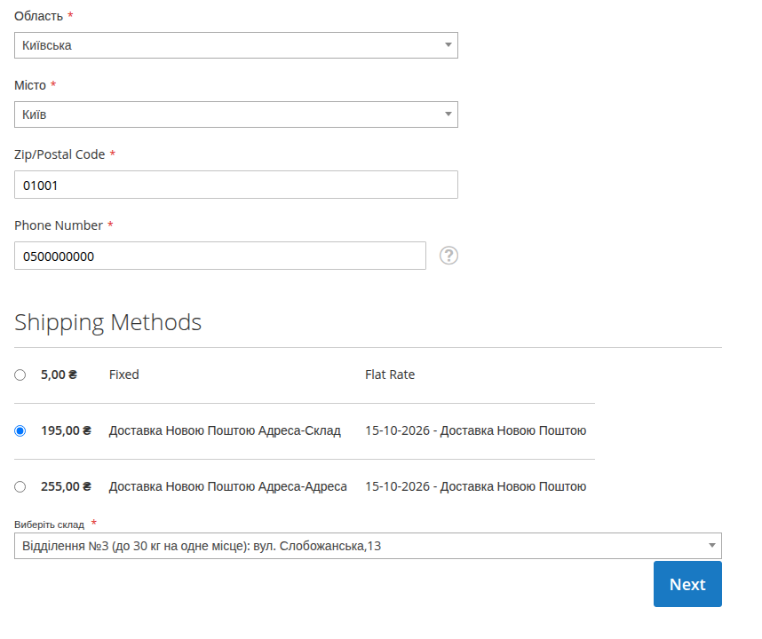
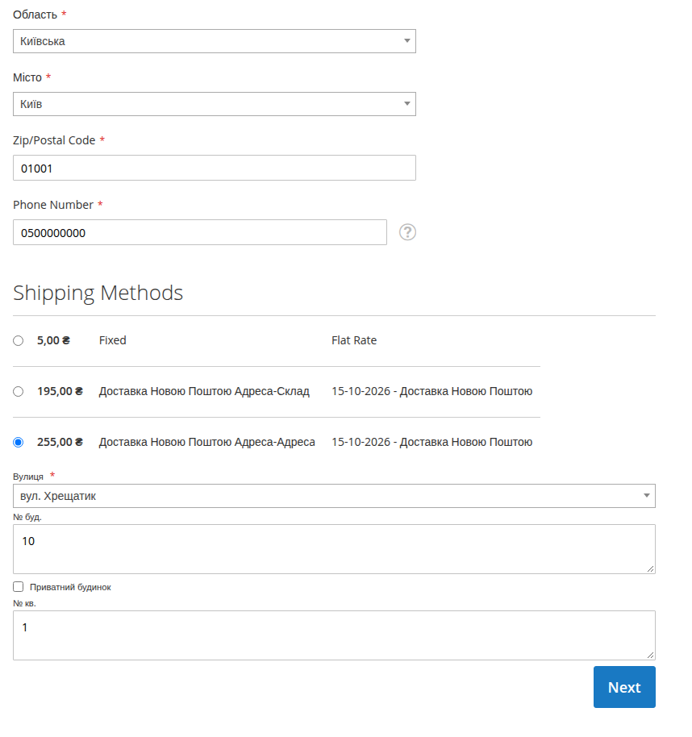
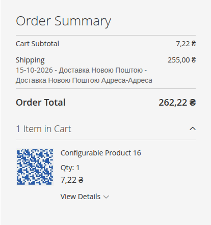
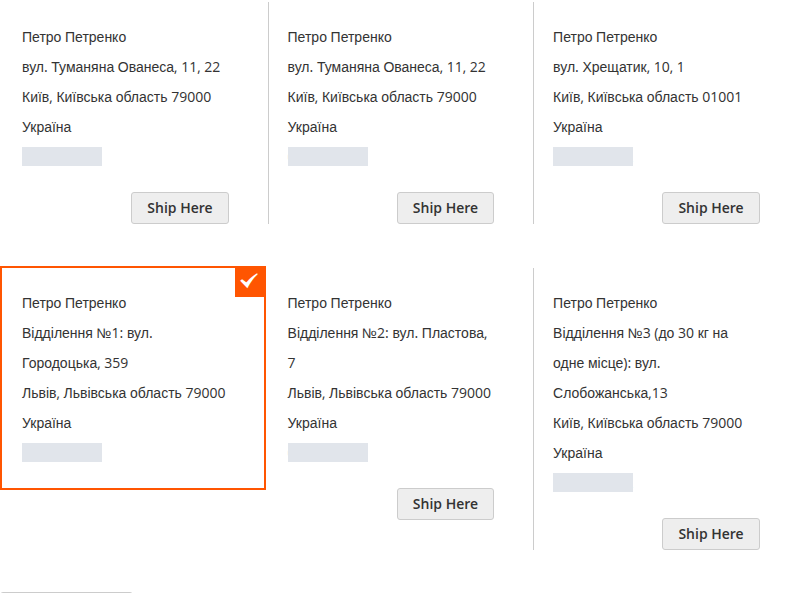
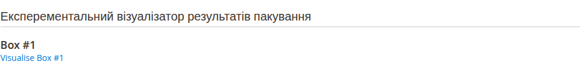
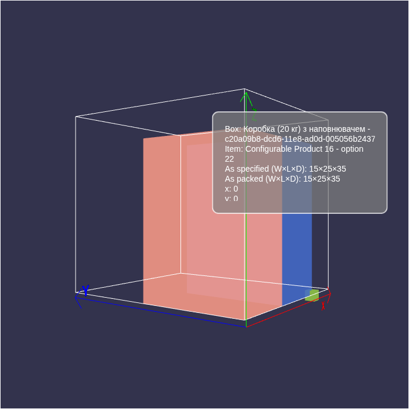
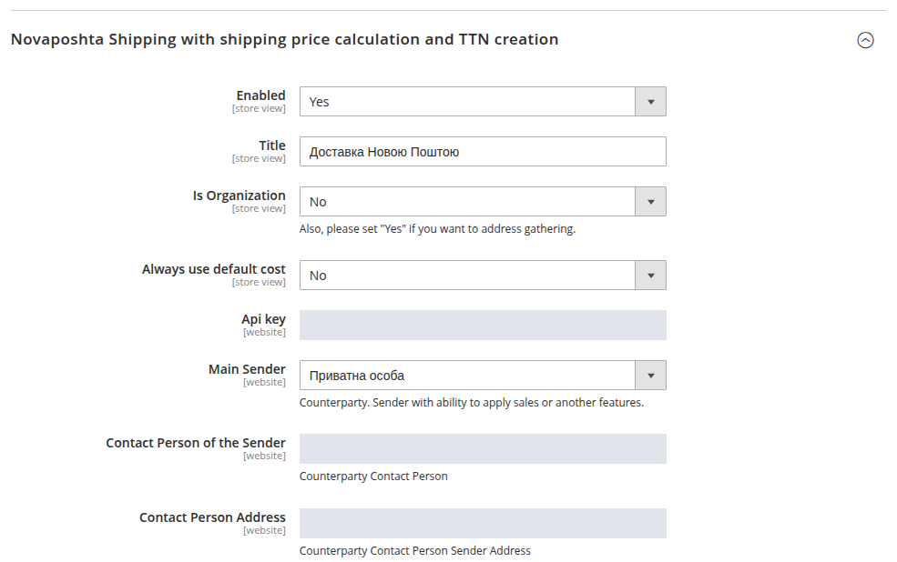

# Perspective Nova Poshta Shipping

[Українська](README.md) · **English**

Nova Poshta delivery for Magento 2. Customers choose a city and branch or
enter a courier delivery address at checkout. Store staff can view those
details in Admin and prepare a waybill (TTN) in the shipment form.

The module requests shipping costs and estimated delivery dates from Nova
Poshta, uses product weight and dimensions, and selects packaging with
BoxPacker. For stores dispatching from several cities, the calculation
compares the available options. You can also set a fixed shipping price.



*Magento Luma calculation for one unit of Configurable Product 16:
weight 3 kg, dimensions 150 × 250 × 350 mm. Delivery to a branch in Kyiv
costs UAH 195. The price and estimated date come from the Nova Poshta API
and depend on the route, products and sender settings.*

## Choosing delivery at checkout

For delivery within Ukraine, customers select a Nova Poshta method, search
for their city by name and choose where to receive the parcel. City search
results include the region to help distinguish places with the same name.

- Branch delivery offers a search for pickup locations in the selected city.
  The list uses [Nova Poshta Catalog](https://github.com/PerspectiveTeam/NovaposhtaCatalog#readme) directories.
- Door delivery lets customers select a street and enter a building and
  apartment number. The **Private house** checkbox allows an address without
  an apartment number.
- Changing the city clears the branch and street fields, so the order
  cannot keep a location from the previous city.



*Nova Poshta calculates door delivery in Kyiv at UAH 255 for the same product.
Field labels depend on the store's locale.*

At the payment step, the calculated shipping price is included in the order
total. Customers can see the product and shipping prices separately.



*Demo store totals: product UAH 7.22, shipping UAH 255, total UAH 262.22.*

### Saved addresses

Signed-in customers can choose an address from their address book. The
module restores its Nova Poshta details, including the city, branch or
street. If the address cannot be resolved unambiguously or does not match
the selected delivery method, checkout asks the customer to add a new one.



*Saved address examples in a local demo store. Phone numbers are hidden.*

## Working with orders

When creating a shipment, store staff can create a Nova Poshta waybill (TTN)
without leaving Magento 2 Admin. In the **Ship** form, they review recipient
details, select the sender, contact person and dispatch address, then send
the parcel parameters to Nova Poshta.

### Packing visualisation

The Admin order page includes an experimental packing visualiser. Click
**Visualise Box #1** to open a 3D view of the box, showing product placement
and dimensions from the BoxPacker calculation. Each box has its own link.





*Packing example from a demo order. The visualisation opens on the BoxPacker website.*

## Setting up your store

After installation, open **Stores → Configuration → Perspective Studio →
Nova Poshta Shipping**. This links to the carrier settings under
**Sales → Delivery Methods** (**Shipping Methods** in some Magento versions),
in **Novaposhta Shipping with shipping price calculation and TTN creation**.



*The API key, contact person and sender address are hidden.*

1. Enable [Nova Poshta Catalog](https://github.com/PerspectiveTeam/NovaposhtaCatalog#readme), enter an
   API key and set up directory updates. Wait for regions, cities, branches,
   streets and packaging to load. Scheduled updates require Magento cron.
2. Check **Directory Map** in Catalog. It maps Nova Poshta regions to Magento
   regions for address selection.
3. In Shipping settings, set **Enabled** to Yes, enter an API key and choose
   the delivery title. Catalog and Shipping each have their own API key setting.
4. Set **Is Organization** for your sender type. Select **Main Sender**,
   **Contact Person of the Sender** and **Contact Person Address**. These
   lists use information from your Nova Poshta account.
5. In **Cities with Warehouse**, choose your dispatch cities. They are used
   to calculate shipping costs; TTN creation uses the sender address chosen
   in the shipment form.
6. Select the required **Allowed Methods**, review the price rules and save
   the configuration. Fill in product weight and dimensions.

### Delivery methods

In these labels, **Warehouse** means a Nova Poshta branch and **Client**
means the sender's or recipient's address.

| Setting | Route | Customer selects or enters |
| --- | --- | --- |
| Warehouse to Warehouse (`w2w`) | Branch → branch | Pickup branch |
| Warehouse to Client (`w2c`) | Branch → address | Street, building and apartment, or a private house |
| Client to Warehouse (`c2w`) | Address → branch | Pickup branch |
| Client to Client (`c2c`) | Address → address | Street, building and apartment, or a private house |

### Pricing and product details

| Setting | Purpose |
| --- | --- |
| Always use default cost | Use the configured price instead of the calculated quote. Also suitable for merchants who want a fixed delivery price instead of calculating Nova Poshta rates |
| Default Cost | Fixed price or fallback when a calculation is unavailable |
| Lathing cost | Wooden crating surcharge in cargo and pallet calculations |
| Free shipping cost | Merchandise subtotal threshold for crating and free shipping rules |

The **Free shipping cost** label does not mean that every order above the
threshold receives free delivery. The rule depends on the result of the
**Special Price** product check. Test it with your catalog before launch.
**Always use default cost** takes precedence over the calculated price.

Products need the standard **Weight** in kilograms and the module's
**Width**, **Length** and **Height** attributes in millimetres. BoxPacker
uses them with the packaging directory to calculate parcel seats. For
configurable products, fill in weight and dimensions for the associated
simple variations as well. At a total weight of 85 kg or more, the calculation
switches to the **Pallet** cargo type.

In two-step checkout, the price may be updated after the address is saved
and the customer moves to payment. Before launch, check the final price in
the store currency, especially when the base and storefront currencies differ.

## For developers

### Requirements and compatibility

A Nova Poshta API key is required.

### Installation

From the Magento root, using your project's PHP environment:

```bash
composer require perspectiveteam/module-novaposhtashipping
php bin/magento module:enable Perspective_NovaposhtaCatalog Perspective_NovaposhtaShipping
php bin/magento setup:upgrade
php bin/magento cache:clean config layout block_html eav
```

Composer installs the dependencies with the module. In production, compile
DI and deploy static content according to your project's deployment process.

To install from source, place the module in
`app/code/Perspective/NovaposhtaShipping`, install the dependencies listed in
[composer.json](composer.json), then follow the same Magento activation and
upgrade steps. Install Shipping once, either in `app/code` or through Composer.

<details>
<summary>Integration points</summary>

### Module structure

| Component | Purpose |
| --- | --- |
| [Model/Carrier/](Model/Carrier/) | `novaposhtashipping` carrier, methods, price and delivery date requests |
| [Helper/Boxpacker.php](Helper/Boxpacker.php) | Packaging selection by weight and dimensions |
| [Model/Carrier/ShippingSales.php](Model/Carrier/ShippingSales.php) | Surcharge, threshold and fixed price rules |
| [view/frontend/](view/frontend/) | Checkout, address search and state restoration |
| [Model/CustomerAddress/DeliveryData.php](Model/CustomerAddress/DeliveryData.php) | Restoring Nova Poshta details from a saved address |
| [Model/Shipment/](Model/Shipment/) | Creating a Nova Poshta internet document |
| [etc/extension_attributes.xml](etc/extension_attributes.xml) | Nova Poshta data in the quote address |
| [Test/](Test/) | Existing PHP unit tests and JavaScript tests for checkout and Admin |

### REST and address persistence

[etc/webapi.xml](etc/webapi.xml) defines public POST directory search routes
under `/V1/novaposhtashipping/`. The main routes are:

| Route | Parameters |
| --- | --- |
| `area` | `term` |
| `city` | `term`, optional `areaRef`, `includeArea` |
| `filtered_warehouses` | `cityRef`, `term`, optional `pageSizes`, `currentPage` |
| `streets-formatted-for-select` | `cityRef`, `term` |

Prepared repositories return a JSON string containing `{id, text}` entries.
Account for this when parsing the REST response. `includeArea` adds `areaRef`
and `areaLabel` to city results. Catalog determines record availability for
new selections.

Checkout sends Ref values and address fields through quote address
`extension_attributes` with the `perspective_novaposhta_shipping_` prefix:
`area`, `city`, `warehouse`, `street`, `building`, `flat`, `is_private_house`,
`method`. Address book data uses the `novaposhta_shipping_data` attribute.
For addresses without Ref values, restoration accepts only exact, unique
matches. Ambiguous details require a new selection by the customer.

Data patches add product dimensions, the address book attribute and metadata
for three Street Address lines. The module's cache type is
`novaposhta_operations_cache`. After changing data that affects shipping
prices, check that this cache is current.

</details>

## License

[MIT](LICENSE.md) · Perspective Studio
